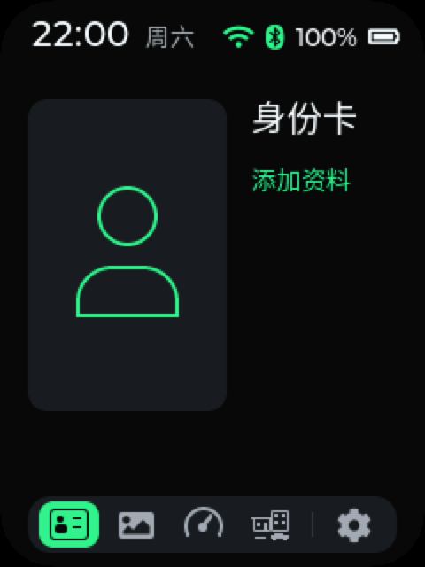
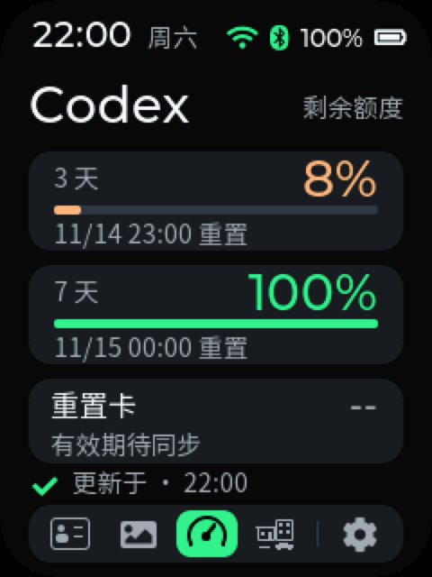
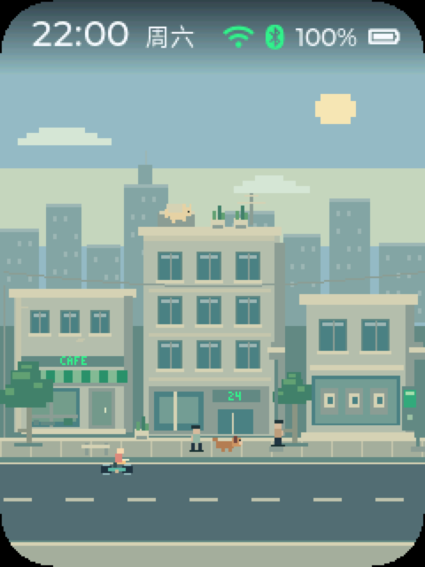

# Passport 口袋伙伴

把 AI Passport 变成随身身份卡、全屏相册和像素小城。搭配 Passport Sync，可在卡片上查看 Codex 剩余额度、重置卡和任务进度，并在任务完成时收到提示。

| 身份卡 | Codex 同步 | 像素街角 |
| --- | --- | --- |
|  |  |  |
| 在网页编辑头像和介绍 | 查看不同额度周期及重置时间 | 短按确认切换不同场景 |

图为固件界面渲染，时间、电量和额度为示例。

## 功能

- **身份卡和全屏相册**。在手机或电脑网页编辑身份资料、裁剪图片，保存最多三张照片。关机后会记住上次显示的照片。
- **像素动画**。在街角、公园和海湾之间切换。校时后，场景随本地时间切换白天、黄昏和夜晚。
- **Codex 同步**。配对 Mac 后可查看剩余额度、重置卡和正在进行的任务。任务完成提示音可开关、试听和调节音量。

## 下载与刷入

在 [v1.1.5 发布页](https://github.com/CCraster/folotoy-ai-passport/releases/tag/v1.1.5) 下载所需文件。

| 文件 | 用途 |
| --- | --- |
| `FoloToy-AI-Passport-full.bin` | AI Passport 的完整固件，从地址 `0x0` 刷入 |
| `Passport-Sync-v1.4.0-macOS-arm64.zip` | 可选的 Apple 芯片 Mac 同步应用 |
| `SHA256SUMS` | 校验两个下载文件 |

刷入会替换当前玩法，已有设置和资料可能被覆盖。请先通过当前玩法的导出功能另存重要资料，并保留设备背面的原厂恢复二维码。用 Chrome 或 Edge 打开 [FoloToy 本地玩法安装工具](https://ai-passport.folotoy.cn/tools/web-flasher/)，选择下载的 `.bin`，给卡片开机并用 USB 数据线连接，再按工具提示安装。手动使用 esptool 时，将完整固件写到 `0x0`。需要恢复默认玩法时，使用你自己设备背面的二维码和 [FoloToy 原厂恢复说明](https://ai-passport.folotoy.cn/guides/restore-factory-firmware/)。

## 第一次使用

- 用上下键切换身份卡、照片、Codex 和动画。照片、额度和动画页短按确认分别切换照片、额度布局和场景。
- 长按确认进入设置。打开「连接 → 网页设置」后，同一局域网可扫码直接进入。卡片未联网时，先扫机身热点二维码加入热点，再扫网页二维码。
- 在网页中设置身份资料、上传最多三张照片、调整开机音乐和备份资料。配置完成后，在卡片上长按确认退出网页设置。

## 在卡片上看 Codex 额度

Mac 预览 ZIP 可直接解压安装，应用采用临时签名，未经 Apple 公证。先在 Mac 安装并登录 Codex CLI，再按[Passport Sync 安装说明](MAC-INSTALL.zh-CN.md)首次打开和蓝牙配对。说明同时提供源码安装方式。

## 从源码构建固件

激活 [ESP-IDF 5.5.3](https://docs.espressif.com/projects/esp-idf/en/v5.5.3/esp32c3/get-started/index.html)，在项目根目录运行 `make test` 和 `make build`。宿主测试需要 C 编译器和 Node.js。合并镜像可以在 `firmware/` 运行 `idf.py merge-bin -o build/FoloToy-AI-Passport-full.bin` 生成。

封面是固件界面的渲染预览。保留的第三方许可见 [FoloToy BSP](firmware/components/bsp/LICENSE) 和[字库](firmware/main/fonts/OFL.txt)。
