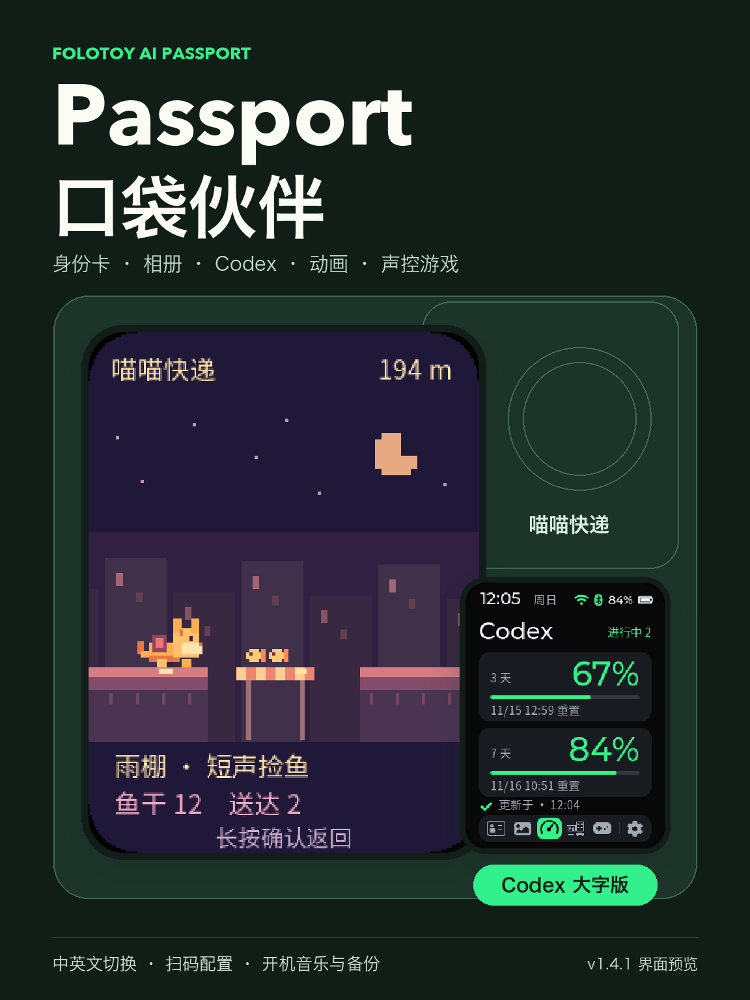
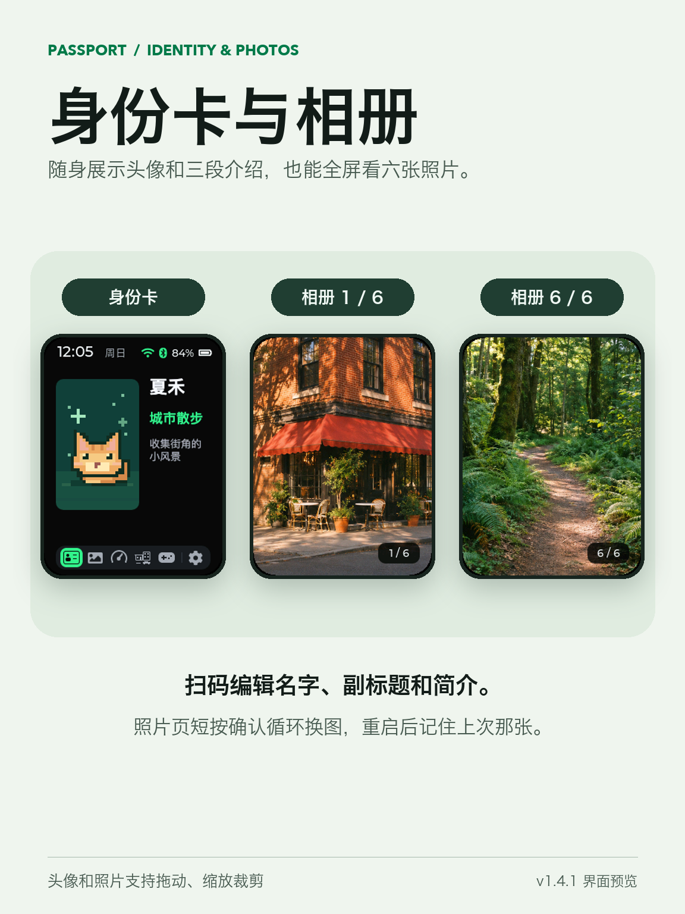
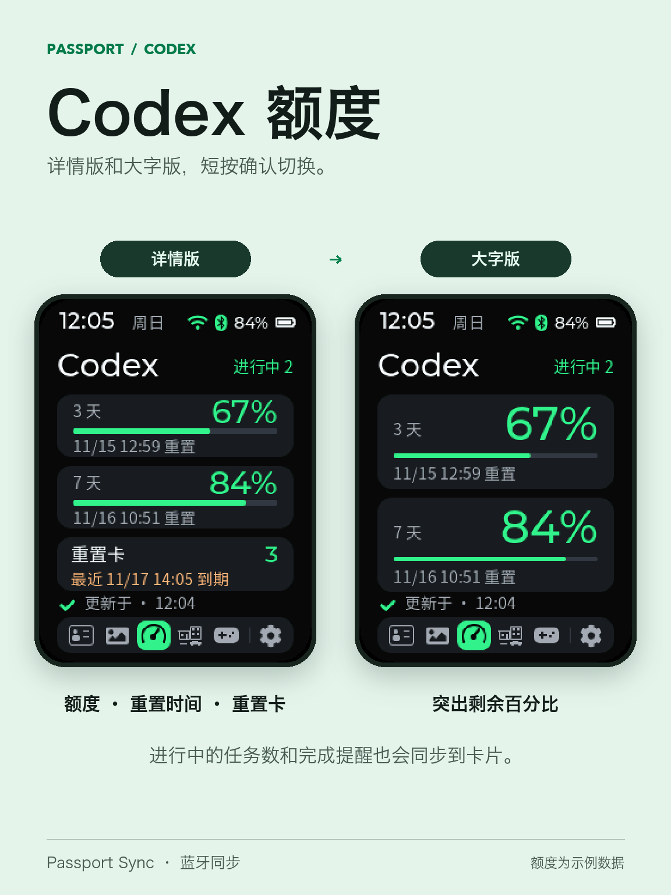
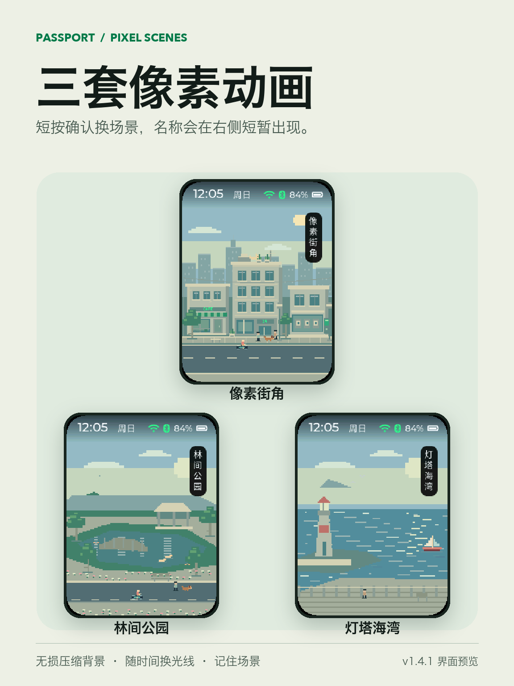
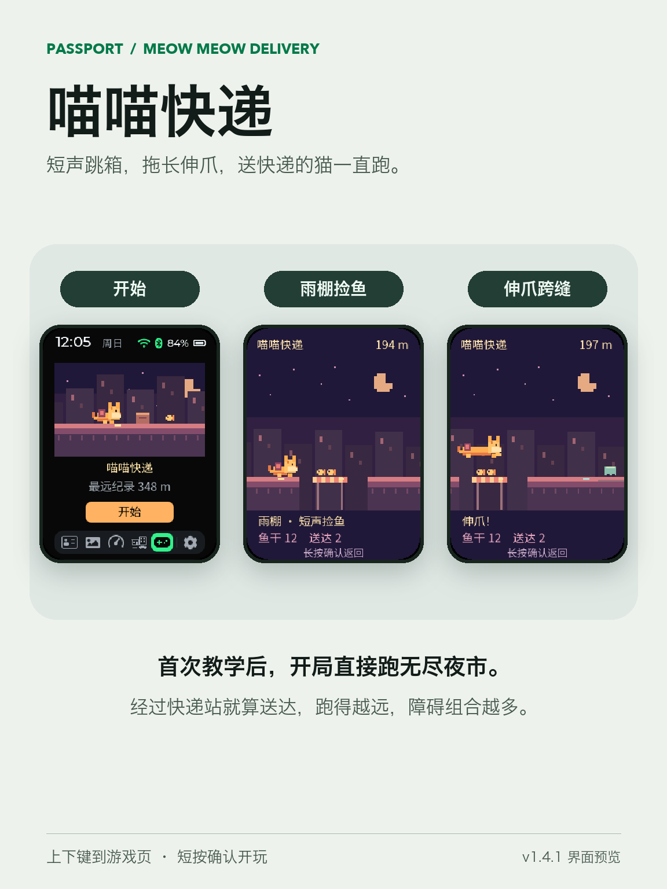

# Passport 口袋伙伴

把 AI Passport 变成随身身份卡、六槽全屏相册、像素小城和声控跑酷。搭配 Passport Sync，可在卡片上查看 Codex 剩余额度、重置卡和任务进度，并在任务完成时收到提示。

## 功能

### 身份卡

在手机或电脑的设置网页里编辑头像和三段文字，分别填写名字、副标题和介绍。三段文字用不同字号和颜色。选头像时可拖动位置和缩放，确认裁剪后保存到卡片，离线也能展示。

### 全屏相册

最多保存 **6 张照片**。在「设置 → 连接 → 设备配置」打开「相册」，选择一个位置即可添加、替换或删除。上传时可拖动和缩放裁剪，网页也会标出卡片正在展示哪张。

在卡片照片页短按确认，循环切换已保存的照片。换图时会短暂显示序号，随后回到纯照片的全屏画面。已保存的照片可离线查看，重启后会回到上次选中的那张。

### Codex 额度 · 两种布局

用 Passport Sync 和卡片蓝牙配对后，在 Codex 页**短按确认**切换布局。卡片会记住上次选中的布局。

| 详情版 | 大字版 |
| --- | --- |
| 查看各周期额度、进度条和重置时间，以及重置卡数量和最近到期时间。 | 放大剩余百分比，仍显示额度周期、重置时间、状态栏及底部导航。只有一个额度周期时用大号数字，两个周期时上下排列。 |

卡片会显示进行中的任务数，也能在任务完成时提示。可在「显示与声音 → 任务完成提示音」开关声音、试听，并选择跟随系统音量或单独调整。

### 像素动画 · 三个场景

动画页**短按确认**依次切换像素街角、林间公园和灯塔海湾。切换时，场景名会在右侧竖排显示约两秒。动画铺满屏幕，顶部叠加时间、连接状态和电量。校时后，背景会随本地时间切换白天、黄昏和夜晚。重启后仍会使用上次选中的场景。

### 喵喵快递

从动画页按下键进入「游戏」，短按确认开始。用短声跳过矮箱和推车，把声音拖长可以在半空伸爪跨缝。短跳落到雨棚可捡鱼，再跳一次过缝。首次完成教学后，之后开局直接跑无尽路线。经过快递站会增加送达数，猫继续跑。跑得越远，障碍组合越紧凑。

游戏中短按确认暂停或继续，长按回封面。正式路线每局有一次救援，第二次掉落结算并记下最远距离。声音的强度和时长用于控制，普通人声也可能触发。

以上画面由 v1.4.1 固件界面渲染。头像、照片和状态数据为示例。

v1.4.1 修复了「任务完成提示音」详情页中文标题显示方框的问题。

### 中英文与设备配置

在机身「设置 → 设备管理 → 语言」或配置页「设备管理 → 设备语言」选择中文或 English。卡片重启后保留所选语言。Mac 应用可以在「应用设置 → 界面语言」独立选择跟随系统、简体中文或 English，并通过「设备配置…」打开同一设备配置页。

「存储」显示固件占用、应用分区余量和相册用量。像素小城背景按行无损压缩，发布构建所用的应用分区仍为 3 MiB。

### 开机音乐与备份恢复

开机音乐可以选内置旋律，也可以在设置网页上传乐谱并试听。在网页「设备管理 → 备份与恢复」或 Passport Sync 菜单栏的「备份与恢复…」里，可以导出或恢复身份卡、照片和常用设置。

## 下载与刷入

在 [v1.4.1 发布页](https://github.com/CCraster/folotoy-ai-passport/releases/tag/v1.4.1) 下载所需文件。

| 文件 | 用途 |
| --- | --- |
| `FoloToy-AI-Passport-full.bin` | AI Passport 的完整固件，从地址 `0x0` 刷入 |
| `Passport-Sync-v1.5.0-macOS-arm64.zip` | 可选的 Apple 芯片 Mac 同步应用 |
| `SHA256SUMS` | 校验两个下载文件 |

刷入会替换当前玩法，已有设置和资料可能被覆盖。请先通过当前玩法的导出功能另存重要资料，并保留设备背面的原厂恢复二维码。用 Chrome 或 Edge 打开 [FoloToy 本地玩法安装工具](https://ai-passport.folotoy.cn/tools/web-flasher/)，选择下载的 `.bin`，给卡片开机并用 USB 数据线连接，再按工具提示安装。手动使用 esptool 时，将完整固件写到 `0x0`。需要恢复默认玩法时，使用你自己设备背面的二维码和 [FoloToy 原厂恢复说明](https://ai-passport.folotoy.cn/guides/restore-factory-firmware/)。

## 第一次使用

- 用上下键切换身份卡、照片、Codex、动画和游戏。照片、额度和动画页短按确认分别切换照片、额度布局和场景。
- 长按确认进入设置。打开「连接 → 设备配置」后，同一局域网可扫码直接进入。卡片未联网时，先扫机身热点二维码加入热点，再扫网页二维码。
- 在配置页编辑身份资料、上传最多六张照片、调整开机音乐和备份资料。配置完成后，在卡片上长按确认退出设备配置。

## 在卡片上看 Codex 额度

Mac 预览 ZIP 可直接解压安装，应用采用临时签名，未经 Apple 公证。先在 Mac 安装并登录 Codex CLI，再按[Passport Sync 安装说明](MAC-INSTALL.zh-CN.md)首次打开和蓝牙配对。说明同时提供源码安装方式。

## 从源码构建固件

激活 [ESP-IDF 5.5.3](https://docs.espressif.com/projects/esp-idf/en/v5.5.3/esp32c3/get-started/index.html)，在项目根目录运行 `make test` 和 `make build`。宿主测试需要 C 编译器和 Node.js。合并镜像可以在 `firmware/` 运行 `idf.py merge-bin -o build/FoloToy-AI-Passport-full.bin` 生成。

封面是固件界面的渲染预览。保留的第三方许可见 [FoloToy BSP](firmware/components/bsp/LICENSE) 和[字库](firmware/main/fonts/OFL.txt)。
